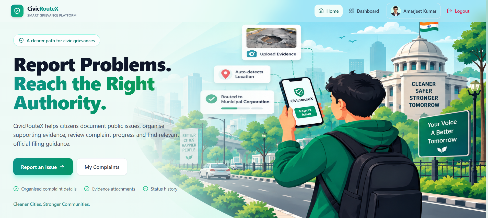
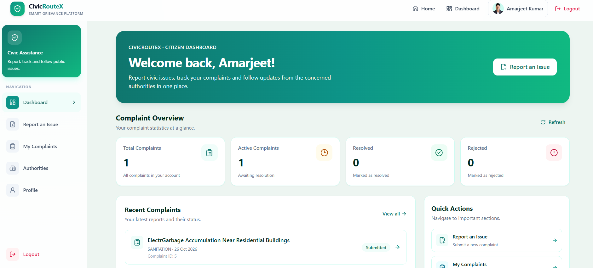
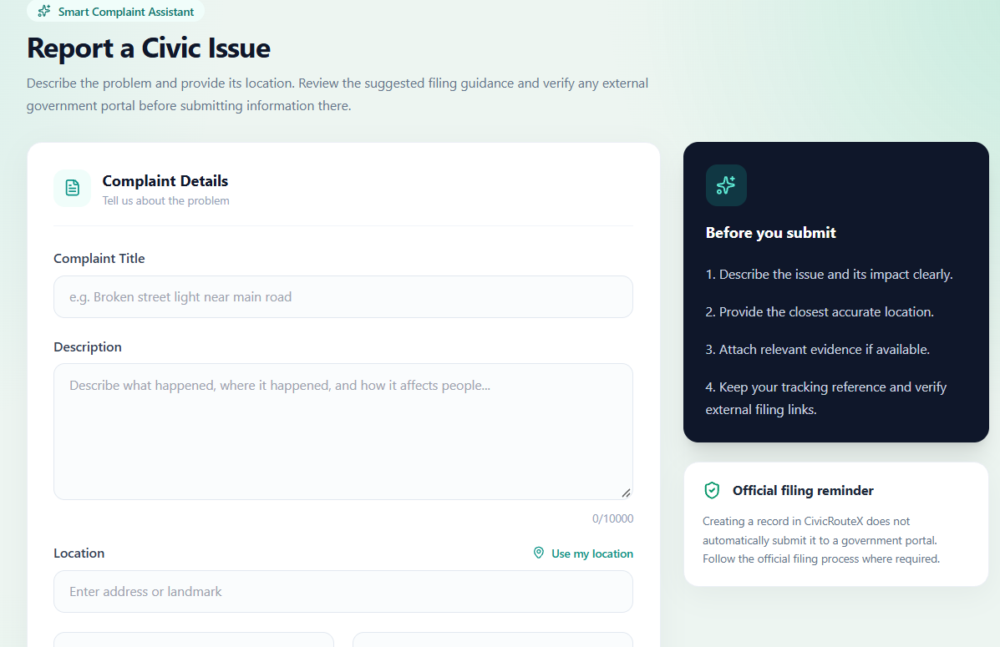
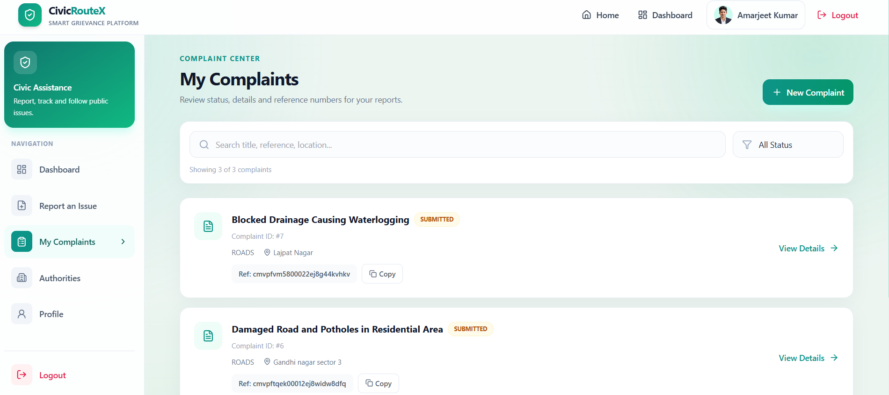
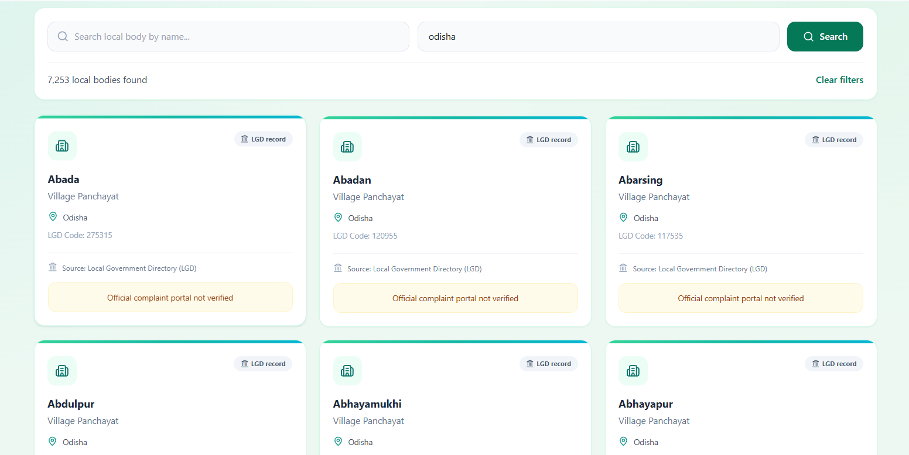

# CivicRouteX 🏛️

A modern, full-stack **civic complaint management and authority-routing platform** built using **React.js, Tailwind CSS, Node.js, Express.js, and PostgreSQL**.

CivicRouteX helps citizens report civic issues such as potholes, garbage accumulation, drainage problems, and water supply disruptions. It aims to identify the appropriate local authority using location information and India's Local Government Directory (LGD) data, helping citizens find the relevant complaint channel.

---

## Features ✅

- **User Authentication & Email Verification**
  - Citizen registration and login.
  - Secure password hashing using bcryptjs.
  - JWT-based authentication.
  - Token-based email verification.

- **Civic Complaint Management**
  - Report civic issues with a title and detailed description.
  - Provide location information.
  - Attach supporting evidence and photographs.
  - Generate complaint tracking numbers.
  - Track complaint status and history.

- **Location-Based Authority Routing**
  - Resolve complaint locations using administrative data.
  - Identify the relevant LGD local body.
  - Determine the appropriate authority using configured routing rules.
  - Provide available authority details and official portal information.

- **LGD Data Integration**
  - Integrate India's Local Government Directory data.
  - Synchronize local-body records from the configured data source.
  - Support location-to-local-body matching.
  - Store administrative data in PostgreSQL.

- **Complaint Status Management**
  - `SUBMITTED`
  - `UNDER_REVIEW`
  - `IN_PROGRESS`
  - `RESOLVED`
  - `REJECTED`

- **Evidence & Timeline Management**
  - Associate evidence with complaints.
  - Maintain complaint timeline records.
  - Use relational database constraints for data integrity.

- **Authority Directory**
  - Browse available authority records.
  - Search and filter authorities.
  - View available authority and official portal information.

- **Citizen Dashboard**
  - Access complaint-related information.
  - View submitted complaints and their statuses.
  - Navigate between complaint registration, complaint history, authorities, and profile.

- **Responsive UI**
  - Built with React.js and Tailwind CSS.
  - Reusable components and interactive navigation.
  - Responsive layouts for desktop, tablet, and mobile.

---

## Tech Stack 🛠️

- **Frontend:** React.js, Vite, Tailwind CSS, React Router, Lucide React
- **Backend:** Node.js, Express.js, REST APIs
- **Database:** PostgreSQL
- **ORM:** Prisma
- **Authentication:** JWT, bcryptjs
- **File Uploads:** Multer
- **Email Verification:** Nodemailer
- **Administrative Data:** India Local Government Directory (LGD)
- **Deployment:** Render, where configured
- **Version Control:** Git and GitHub

---

## System Architecture 🏗️

CivicRouteX follows a client-server architecture.

1. The citizen interacts with the React.js frontend.
2. The frontend communicates with the Express.js backend through REST APIs.
3. The backend handles authentication, complaint management, location resolution, and authority routing.
4. Prisma ORM manages database operations.
5. PostgreSQL stores user accounts, complaints, evidence, timelines, and administrative data.
6. LGD data supports local-body identification and location-based routing.

---

## Project Structure 📁

```text
CivicRouteX/
├── frontend/
│   ├── public/
│   ├── src/
│   │   ├── assets/
│   │   ├── components/
│   │   ├── data/
│   │   ├── pages/
│   │   └── main.jsx
│   ├── index.html
│   └── package.json
│
├── backend/
│   ├── prisma/
│   │   └── schema.prisma
│   ├── scripts/
│   ├── src/
│   │   ├── config/
│   │   ├── controllers/
│   │   ├── middleware/
│   │   ├── routes/
│   │   └── services/
│   └── package.json
│
└── README.md
```

---

## Getting Started 🚀

### Prerequisites

- Node.js and npm
- PostgreSQL
- Git

### 1. Clone the Repository

```bash
git clone https://github.com/Amar-6003/CivicRouteX
cd CivicRouteX
```

### 2. Install Backend Dependencies

```bash
cd backend
npm install
```

### 3. Configure the Database

Ensure PostgreSQL is running and the database connection is configured correctly.

Apply existing Prisma migrations:

```bash
npx prisma migrate deploy
```

### 4. Start the Backend

```bash
npm run dev
```

### 5. Install Frontend Dependencies

Open a new terminal:

```bash
cd frontend
npm install
```

### 6. Start the Frontend

```bash
npm run dev
```

---

## Screenshots 🖼️

### Home Page



### Dashboard



### Create Complaint



### My Complaints



### Authority Directory



---

## How to Use 📝

1. Register for a citizen account.
2. Verify your email address.
3. Log in to the application.
4. Open the complaint registration page.
5. Enter the issue description and location.
6. Attach supporting evidence, if available.
7. Review the available local-body and authority-routing information.
8. Submit the complaint and receive its tracking number.
9. Visit My Complaints to review the complaint status and details.
10. Use the Authority Directory to explore available authority information.

---

## Database Design 🗄️

CivicRouteX uses PostgreSQL with Prisma ORM.

The main data entities include:

- **User:** Citizen account and authentication information.
- **Complaint:** Complaint details, location, category, priority, status, tracking number, and routing metadata.
- **Evidence:** Evidence records associated with complaints.
- **ComplaintTimeline:** Complaint events and status history.
- **LGD Local Body:** Administrative local-body data.
- **Authority:** Available authority information and official portal metadata.

---

## Security 🔒

- Password hashing using bcryptjs.
- JWT-based authentication.
- Token-based email verification.
- Protected API endpoints.
- Secure handling of environment variables.
- Validation and secure handling of uploaded files.
- Relational database constraints for data integrity.

---

## Future Improvements 🚀

- **AI-Assisted Complaint Analysis:** Improve classification, summaries, and suggested next steps using an LLM.
- **Advanced Geospatial Routing:** Explore PostgreSQL/PostGIS for more precise location matching.
- **Verified Authority Directory:** Expand verified official contacts and complaint portal coverage.
- **Background Processing:** Introduce Redis and BullMQ for suitable asynchronous tasks.
- **Cloud Evidence Storage:** Store complaint photographs and documents using cloud object storage.
- **Email Notifications:** Notify citizens about complaint submissions and status changes.
- **Administrative Dashboard:** Improve complaint review and status management.
- **Complaint Analytics:** Add category-wise and location-wise insights.
- **Accessibility Improvements:** Enhance usability across devices and accessibility needs.
- **Automated Testing:** Add backend, API, and frontend tests.

---

## Author 👨‍💻

**CodeWithAmar**

- **Portfolio:** [amarfolio.vercel.app](https://amarfolio.vercel.app)
- **GitHub:** [Amar-6003](https://github.com/Amar-6003)
- **LinkedIn:** [amar6003](https://www.linkedin.com/in/amar6003)

---

## Acknowledgements 🙏

- India's Local Government Directory (LGD) for administrative local-body data.
- React.js for frontend development.
- Node.js and Express.js for backend development.
- PostgreSQL and Prisma for database management.
- Tailwind CSS for responsive UI development.
- The open-source community for its tools and libraries.

---

**CivicRouteX — Making Civic Issue Reporting More Accessible, Transparent, and Better Connected.** 🏛️📍
